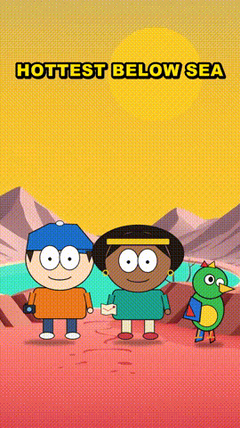
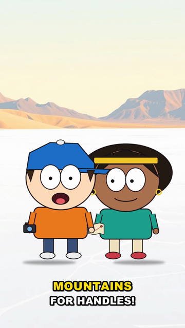
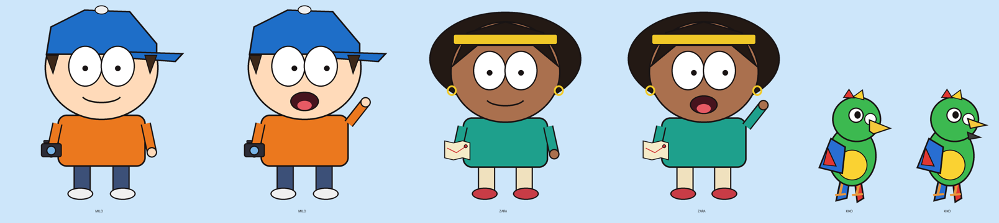
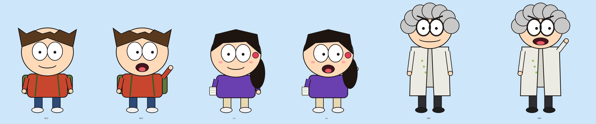

# toon-shorts-factory

**Free, fully automated YouTube Shorts in paper-cutout cartoon style, for any niche, in any language.**

Your own original characters talk to each other, mouths synced to every word, in front of a new background each scene. A script is written from real facts (checked against Wikipedia), voiced, animated, subtitled and uploaded to your channel, twice a day, with zero paid APIs.

🇧🇷 [Leia em português](README.pt-BR.md)

<p align="center">
  
  
</p>
<p align="center"></p>

## What it does

| Step | How | Cost |
|---|---|---|
| Pick a topic | From your `topics.json`, never repeating recent ones, rotating episode formats | free |
| Get the facts | Wikipedia API (any language) | free |
| Write the script | Pollinations text (LLM) with a strict JSON contract: hook ≤ 9 words, escalating facts, loop or comment question | free |
| Fact check | Every sentence the script relies on must exist in the source article, or the script is rejected and rewritten | free |
| Voices | edge-tts neural voices, one voice per character, with word timings | free |
| Animation | Characters drawn 100% in code (Pillow): lip sync, blinking, gaze, gestures | free |
| Backgrounds | Pollinations Flux in a consistent paper-cutout style, cached; code-drawn fallback offline | free |
| Subtitles | Word-by-word karaoke + on-screen hook text for the first 3 s | free |
| SEO | Real YouTube autocomplete searches feed the title, tags and description | free |
| Upload | YouTube Data API v3 (your own OAuth app, your channel) | free |
| Learn | Reads views of past episodes and logs your top topics and formats | free |

## Why it is built this way (monetization)

YouTube demonetizes channels for **inauthentic content**: mass-produced, template-like or repetitive videos. This project is designed against that:

* a **recurring original cast** with personalities, not a faceless slideshow;
* **real, verifiable facts** with the source credited in every description;
* **rotating formats** (facts, myth vs fact, guess where, could you survive...) so episodes do not look templated;
* **no sensitive personas**: characters never act as financial, medical or legal experts.

Read [docs/monetization.md](docs/monetization.md) before you start. Shorts alone pay little; the doc explains the path that actually reaches the Partner Program.

## Quick start (Windows)

```bat
git clone https://github.com/superaplicativos/toon-shorts-factory
cd toon-shorts-factory
setup_windows.bat
```

The installer puts Python, ffmpeg and every package inside the project folder. Then:

1. **Keys** (both free): create the Google OAuth file and the Pollinations key, see [docs/youtube-setup.md](docs/youtube-setup.md). Save them in `secrets/`.
2. **Your channel**: `toonshorts new my-channel` and edit `channels/my-channel/channel.json` + `topics.json` ([docs/channel-config.md](docs/channel-config.md)). Or let Claude do it with the skill (below).
3. **See your cast**: `toonshorts cast my-channel` creates `cast_preview.png`.
4. **Test without uploading**: `toonshorts preview my-channel`.
5. **Connect YouTube**: create the channel on YouTube first, then `toonshorts authorize my-channel` and pick that channel on Google's screen (add `--paste` if the browser cannot reach localhost).
6. **Private pilot**: `toonshorts pilot my-channel`, then check it in YouTube Studio.
7. **Go daily**: `toonshorts schedule my-channel`. The PC must be on at the scheduled times.

macOS / Linux: `./setup.sh`, then the same commands with `.venv/bin/python -m toonshorts <command>`; `schedule` prints crontab lines.

## Use it with Claude (skill)

The folder [`skill/toon-shorts-channel`](skill/toon-shorts-channel/SKILL.md) is an Agent Skill. Add it to Claude (claude.ai → Settings → Capabilities → Skills, or copy it into your Claude Code skills folder) and say:

> "Create a toon-shorts channel about ___ in ___ language"

Claude interviews you about the niche, designs the cast (looks, voices, personalities), writes the formats and a topic list of 200+ items, renders the cast preview and walks you through authorization, the pilot and scheduling.

## Examples included

| Channel | Niche | Language |
|---|---|---|
| `world-tour-toons` | travel and geography facts, a new place every episode | English |
| `historia-em-1-minuto` | "what if you lived in..." history | Portuguese (BR) |
| `_template` | starting point for `toonshorts new` | English |

<p align="center"></p>

## Project layout

```
toonshorts/          the engine (pipeline, animation, characters, free AI providers, YouTube)
channels/<slug>/     one folder per channel: channel.json, topics.json, history.json, output/
secrets/             your keys (git-ignored)
skill/               Claude skill that builds a channel with you
docs/                setup, config reference, monetization, troubleshooting
```

## Commands

| Command | What |
|---|---|
| `toonshorts list` | list channels |
| `toonshorts new <slug> [--from <other>]` | create a channel from the template or another channel |
| `toonshorts cast <slug>` | render the cast preview |
| `toonshorts check [<slug>]` | check tools, keys and YouTube connection |
| `toonshorts authorize <slug> [--paste]` | connect the YouTube channel (once) |
| `toonshorts preview <slug>` | make one video, no upload |
| `toonshorts pilot <slug>` | make one video and upload it as private |
| `toonshorts run <slug> [--private] [--force]` | the daily job |
| `toonshorts schedule <slug>` | daily tasks (Windows) or crontab lines |

## Hard-won lessons (already handled)

* On some Windows ffmpeg builds, piping frames + audio + subtitles in one pass, or using `loudnorm`, **hangs forever**. Rendering is two-pass and uses `volume + alimiter`.
* Child ffmpeg processes must get `-nostdin`, or they can block on the console.
* edge-tts sometimes answers "No audio was received" for no reason; every line is retried.
* Google's OAuth redirect to localhost does not always fire in embedded browsers; `authorize --paste` solves it.
* Unverified Google Cloud apps may get uploads locked as private until the app passes the audit. See [docs/youtube-setup.md](docs/youtube-setup.md).

More in [docs/troubleshooting.md](docs/troubleshooting.md).

## License

MIT for the code. Facts come from Wikipedia under CC BY-SA 4.0 and are credited in each video description. You are responsible for following YouTube's policies on your channel.
