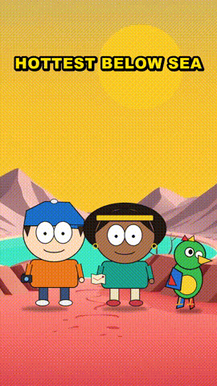
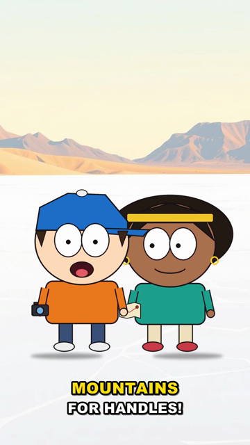
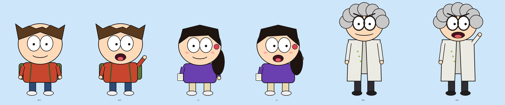

# toon-shorts-factory

**Shorts do YouTube em desenho animado estilo papel recortado, 100% automáticos e gratuitos, para qualquer nicho e em qualquer idioma.**

Os seus próprios personagens originais conversam entre si, com a boca sincronizada a cada palavra, na frente de um cenário diferente em cada cena. O roteiro é escrito a partir de fatos reais (conferidos na Wikipedia), ganha voz, animação e legenda, e é publicado no seu canal duas vezes por dia, sem nenhuma API paga.

🇺🇸 [Read in English](README.md)

<p align="center">
  
  
</p>
<p align="center"></p>

## O que ele faz

| Etapa | Como | Custo |
|---|---|---|
| Escolhe o tema | Do seu `topics.json`, sem repetir os recentes e alternando formatos de episódio | grátis |
| Busca os fatos | API da Wikipedia (qualquer idioma) | grátis |
| Escreve o roteiro | IA de texto do Pollinations com contrato JSON rígido: gancho de até 9 palavras, fatos em escalada, final em loop ou pergunta para os comentários | grátis |
| Checa os fatos | Toda frase em que o roteiro se apoia precisa existir no artigo de origem, senão o roteiro é reprovado e reescrito | grátis |
| Vozes | Vozes neurais do edge-tts, uma voz para cada personagem, com o tempo de cada palavra | grátis |
| Animação | Personagens desenhados 100% em código (Pillow): sincronia labial, piscadas, olhar e gestos | grátis |
| Cenários | Pollinations Flux num estilo de papel recortado consistente, com cache e cenário desenhado por código quando está sem internet | grátis |
| Legendas | Karaokê palavra por palavra e texto de gancho na tela nos 3 primeiros segundos | grátis |
| SEO | Buscas reais do autocompletar do YouTube alimentam título, tags e descrição | grátis |
| Publicação | YouTube Data API v3 (seu próprio app OAuth, seu canal) | grátis |
| Aprendizado | Lê as views dos episódios anteriores e registra os temas e formatos que mais rendem | grátis |

## Por que é feito assim (monetização)

O YouTube tira a monetização de canais com **conteúdo inautêntico**, ou seja, vídeos produzidos em massa, com cara de molde ou repetitivos. Este projeto foi desenhado contra isso. Ele usa um **elenco original e fixo**, com personalidade, e não um slideshow sem rosto. Usa **fatos reais e verificáveis**, com a fonte creditada em toda descrição. **Alterna formatos** (fatos, mito ou verdade, adivinhe onde estamos, você sobreviveria...) para os episódios não parecerem feitos em série. E **nenhum personagem se passa por especialista** em finanças, saúde ou direito.

Leia o [docs/monetization.md](docs/monetization.md) antes de começar. Shorts sozinhos pagam pouco, e o documento explica o caminho que de fato chega ao Programa de Parcerias.

## Começo rápido (Windows)

```bat
git clone https://github.com/superaplicativos/toon-shorts-factory
cd toon-shorts-factory
setup_windows.bat
```

O instalador coloca Python, ffmpeg e todos os pacotes dentro da própria pasta do projeto. Depois:

1. **Chaves** (as duas grátis): crie o arquivo OAuth do Google e a chave do Pollinations seguindo o [docs/youtube-setup.md](docs/youtube-setup.md). Salve as duas em `secrets/`.
2. **Seu canal**: rode `toonshorts new meu-canal` e edite `channels/meu-canal/channel.json` e `topics.json` ([docs/channel-config.md](docs/channel-config.md)). Ou deixe o Claude fazer isso com a skill (veja abaixo).
3. **Veja o elenco**: `toonshorts cast meu-canal` gera o `cast_preview.png`.
4. **Teste sem publicar**: `toonshorts preview meu-canal`.
5. **Conecte o YouTube**: crie o canal no YouTube primeiro, depois rode `toonshorts authorize meu-canal` e escolha esse canal na tela do Google. Se o navegador não conseguir abrir o localhost, acrescente `--paste`.
6. **Piloto privado**: `toonshorts pilot meu-canal`, e confira o vídeo no YouTube Studio.
7. **Rodando todo dia**: `toonshorts schedule meu-canal`. O PC precisa estar ligado nos horários agendados.

No macOS ou Linux, rode `./setup.sh` e depois os mesmos comandos com `.venv/bin/python -m toonshorts <comando>`. O `schedule` mostra as linhas para o crontab.

## Usando com o Claude (skill)

A pasta [`skill/toon-shorts-channel`](skill/toon-shorts-channel/SKILL.md) é uma Skill de agente. Adicione ao Claude (claude.ai → Configurações → Capacidades → Skills, ou copie para a pasta de skills do Claude Code) e diga:

> "Crie um canal toon-shorts sobre ___ em ___"

O Claude entrevista você sobre o nicho, cria o elenco (visual, vozes e personalidades), escreve os formatos e uma lista com mais de 200 temas, gera a prévia do elenco e acompanha você na autorização, no piloto e no agendamento.

## Exemplos incluídos

| Canal | Nicho | Idioma |
|---|---|---|
| `world-tour-toons` | fatos de viagem e geografia, um lugar novo por episódio | inglês |
| `historia-em-1-minuto` | história no formato "e se você vivesse em..." | português |
| `_template` | ponto de partida do `toonshorts new` | inglês |

## Estrutura

```
toonshorts/          o motor (pipeline, animação, personagens, IAs grátis, YouTube)
channels/<slug>/     uma pasta por canal: channel.json, topics.json, history.json, output/
secrets/             suas chaves (fora do git)
skill/               skill do Claude que monta o canal com você
docs/                instalação, referência de configuração, monetização, problemas comuns
```

## Lições aprendidas (já resolvidas no código)

* Em alguns builds do ffmpeg para Windows, mandar quadros, áudio e legendas numa passada só, ou usar o filtro `loudnorm`, **trava para sempre**. Por isso a renderização é feita em duas passadas e o volume usa `volume + alimiter`.
* Os processos do ffmpeg precisam do `-nostdin`, senão podem ficar presos no console.
* O edge-tts às vezes responde "No audio was received" sem motivo. Toda fala é tentada de novo.
* O redirecionamento do OAuth do Google para o localhost nem sempre dispara em navegadores embutidos. O `authorize --paste` resolve.
* Apps do Google Cloud não verificados podem ter os uploads travados como privados até passar pela auditoria. Veja o [docs/youtube-setup.md](docs/youtube-setup.md).

Mais detalhes em [docs/troubleshooting.md](docs/troubleshooting.md).

## Licença

O código é MIT. Os fatos vêm da Wikipedia sob CC BY-SA 4.0 e são creditados na descrição de cada vídeo. Seguir as políticas do YouTube no seu canal é responsabilidade sua.
